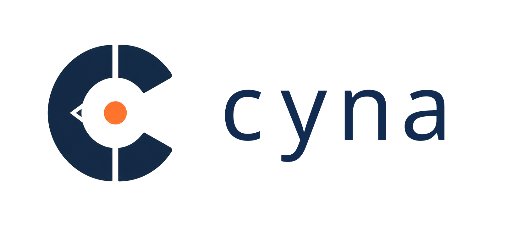

<p align="center">
  
</p>
<p align="center">/ˈsaɪ.nə/</p>

# Cyna

[简体中文](README.zh-CN.md)

Cyna is a C-compatible systems programming language focused on explicit memory,
predictable cleanup, strong value semantics, and low-level control without
turning ordinary code into pointer soup.

If you like C's closeness to the machine but want clearer value semantics,
cleaner module structure, and more explicit ownership behavior, Cyna is meant
to be easy to pick up and easy to inspect.

## Start Here

Install the current release, then run a small program:

```sh
curl -fsSL https://cyna.dev/install.sh | sh
export PATH="$HOME/.cyna/current/bin:$PATH"
cat > hello.cy <<'EOF'
extern {
    c("puts") fn puts(text: c_str): c_int;
}

fn main(): i32 {
    const written = puts("hello from Cyna");
    return 0;
}
EOF
cyna run hello.cy
```

On Windows x64, install from PowerShell:

```powershell
irm https://cyna.dev/install.ps1 | iex
cyna version
```

If you want to inspect what the compiler emits:

```sh
cyna build examples/milestone_app.cy --emit-lir

# Show the slowest compiler phases and semantic function bodies, plus cache counts.
cyna build examples/milestone_app.cy --timings
```

Timing rows are sorted by total duration. Enclosing phases include their child phases, and a function body can trigger nested semantic work, so these times should not be added together. The report also shows the ten slowest semantic function bodies, cache counts, LLVM object reuse, and the number of dropped trace records. Profiling is enabled only with `--timings`.

For common syntax and preferred Cyna usage, see
[`docs/CHEATSHEET.md`](docs/CHEATSHEET.md). For normative language rules, see
[`docs/SPEC.md`](docs/SPEC.md). For consistent terminology, see
[`docs/GLOSSARY.md`](docs/GLOSSARY.md). For AI-assisted Cyna work, the
[`cyna` skill](.agents/skills/cyna/SKILL.md) provides idiomatic syntax, ownership,
library patterns, and verification guidance.

Format source files or a directory, including safe removal of redundant struct
constructor types in directly annotated bindings:

```sh
./scripts/format.sh
./scripts/format.sh --check
```

`--check` leaves files untouched and exits nonzero when formatting is needed or
an input fails. The wrapper formats maintained `.cy` sources and excludes
generated device bindings. See [`docs/BUILD.md`](docs/BUILD.md#source-formatting)
for scope and supported normalizations.

## Built with Cyna

Cyna is used in different kinds of projects:

| Project | Application |
| --- | --- |
| [Cava](https://github.com/neucine/cava) | Java bytecode interpreter and virtual machine |
| Lightcept | macOS desktop app for editing RAW photos |
| [Cory](https://github.com/neucine/cory) | Kernel for AArch64 and RISC-V |

## Why Cyna

Cyna aims to feel familiar to C programmers while making a different set of
defaults cheap:

- values and containers first, pointers when they are actually needed
- visible ownership handoff and predictable cleanup
- `unchecked` as the visible boundary for dangerous operations
- modules instead of headers for normal source organization
- direct C ABI work through `c struct`, `c union`, `c enum`, `extern c`, and
  `export c`
- one pointer model across the language: `^T` owns, `&T` borrows, and `*T` is
  raw; C scalar mappings use the distinct `c_*` family
- typed failures use return-only `T!E`, `throw`, `try`, and `catch`; a scoped
  failure view can read bounded diagnostics without storing a failure value

## Philosophy

Cyna assumes most problems do not need more expressive mechanisms. They need
clearer defaults, tighter boundaries, and fewer ways to do the same thing.

That shows up across the project:

- the language stays small and explicit instead of accumulating many parallel
  feature styles
- the build system prefers conventions and declarative intent over scripting
  and orchestration
- the standard library aims to stay practical and compact instead of growing
  broad abstraction layers for rare cases

The goal is not maximum freedom. The goal is a coherent language and toolchain
whose best practices solve most real work without needing extra machinery.

## Language Highlights

- Predictable ownership shapes:
  values, `List<T>`, `Map<K,V>`, `Set<T>`, `&T`, `^T`, and `*T` each have a
  distinct role.
- Declarative top-level bindings:
  imports do not run arbitrary module code.
- Checked conversions:
  `as` and `as?` are semantic conversions; `as!` is the explicit exact-width
  bit reinterpretation form.
  That includes `c_*` integer names: `c_short -> c_int` still requires `as`,
  widening succeeds, and narrowing stays checked.
- Static protocols and monomorphized generics:
  generic code stays concrete at instantiation time.
- C layout and ABI surface:
  `c struct`, `c enum`, `c union`, ABI scalar names like `c_int`, and generated
  prototype headers.

## A Small Taste

```cyna
type UserId = distinct u64;

struct User {
    id: UserId;
    name: string;
}

fn find_name(users: List<User>, id: UserId): ?string {
    for user in users {
        if user.id == id {
            return user.name;
        }
    }
    return none;
}
```

```cyna
extern {
    c("puts") fn puts(text: c_str): c_int;
}

export c("greet") fn greet(name: c_str): c_int {
    return puts(name);
}

fn main(): i32 {
    // A static literal safely adapts to borrowed, NUL-terminated c_str.
    return puts("hello");
}
```

## Try It

If you want a quick tour with the installed compiler:

```sh
cyna run examples/milestone_app.cy
cyna run examples/union_switch.cy
cyna build examples/ownership_trace.cy --emit-lir
```

If you are working from a checkout and want the broader source-built tour:

Compiler development requires **Zig 0.17.0 exactly** (recorded in
[.zig-version](.zig-version)); other releases are currently unsupported. With
Python 3.12+ and curl available, install the pinned, checksum-verified release:

```sh
python3 scripts/setup_zig.py
export PATH="$PWD/.tools/zig/0.17.0:$PATH"
zig version
```

On Windows, add the directory printed by the setup script to `PATH`. The
compiler package currently also requires the sibling `../zig-libs` checkout
declared in `build.zig.zon`. The verified dependency snapshot is
[`neucine/zig-libs` at `a91b58271be94a4e402a856403fe0fa83add1709`](https://github.com/neucine/zig-libs/tree/a91b58271be94a4e402a856403fe0fa83add1709).
For a fresh workspace, clone that repository to `../zig-libs` and check out
that commit before building. Native hosted builds need the platform C SDK
(Xcode Command Line Tools on macOS); Cyna provisions its LLVM/runtime payloads
separately from this developer Zig setup.

```sh
zig build test
zig build run -- build examples/milestone_app.cy --emit-tok --emit-ast --emit-sir --emit-lir --emit-ll
zig build run -- run examples/raw_pointer_unchecked.cy
zig build run -- run examples/union_switch.cy
zig build run -- build examples/cstruct_point.cy --emit-c-header
zig build run -- build examples/c_header_consumer/api.cy --emit-c-header --output build/c_header_consumer
cc -std=c11 -c examples/c_header_consumer/consumer.c -I build -o build/c_header_consumer_consumer.o
zig build run -- build examples/ownership_trace.cy --emit-lir
```

Run the compiler test suite with the checkout's `.zig-cache` on a filesystem
that preserves Unix file modes and directory enumeration, such as APFS on macOS.
Zig 0.17's `std.testing.tmpDir` creates test fixtures under `.zig-cache/tmp`
regardless of `--cache-dir`. An exFAT-backed `.zig-cache` can make permission
assertions fail and cause duplicate test-file discovery and CLI failures.

More runnable examples live in [`examples/`](examples).

If you are contributing to the compiler itself, building from the repository is
still the right path. The release installer is just a better first experience
for most readers.

`cyna build` now emits a native executable by default. Extra inspection
artifacts can be requested with `--emit-tok`, `--emit-ast`, `--emit-sir`,
`--emit-lir`, `--emit-ll`, and `--emit-c-header`. `cyna run` uses the native path.
When `--output <path>` is provided, the native executable uses that exact path
and emitted side artifacts reuse it as a base, for example `<path>.tok`,
`<path>.ast`, `<path>.h`, and `<path>.ll`.

The emitted LIR still includes an `ownership:` section so you can inspect where
ownership starts, where `take` clears a source, when handoff suppresses source
cleanup, when `defer` runs, and where auto-drops are inserted.
`examples/ownership_trace.cy` is the smallest focused walkthrough.

## Current Native Status

The native backend is no longer just a stub. Current LIR/LLVM coverage includes:

- ownership-driven cleanup, `drop`, `defer`, and the current `take` model
- structs, unions, optionals, results, fixed arrays, slices, dense storage
  `[:]T`, and sparse storage `[;]T`
- `List<T>`, `Map<K,V>`, and `Set<T>` through the current runtime-backed ABI
- raw pointers, ref-based mutation, and unchecked pointer writes
- declarative top-level globals in the current supported subset

Native coverage is still a subset rather than the whole language. In
particular, the remaining gaps are now concentrated in packed-field aliasing
and other intentionally excluded packed-place forms, allocator-context
tightening, and other edges outside the current documented native subset.

The best current implementation-status summary is:

- [docs/STATUS.md](docs/STATUS.md) for implemented features and known limitations
- [docs/RUNTIME.md](docs/RUNTIME.md) for the native runtime and standard library boundary

## Editor Tooling

An initial VS Code extension lives in [`tools/cyna-vscode`](tools/cyna-vscode).
It currently provides syntax highlighting plus basic editor features such as
diagnostics, hover, go-to definition, completion, and document symbols.

## GitHub Language Stats

GitHub Linguist does not have first-class Cyna support yet, and `.cy` is
currently claimed by Cycript in Linguist's language database. This repository
uses `.gitattributes` to mark `.cy` files as Cyna while excluding them from
GitHub language percentages until Cyna is supported upstream.

## Further Reading

CI runs the compiler build, repository checks, and fast tests for ordinary
branches.

Releases are prepared and verified locally with the existing script. Use Python
3.12 or newer and the pinned Zig toolchain:

```sh
python3 scripts/release_distribution.py plan
python3 scripts/release_distribution.py verify
python3 scripts/release_distribution.py status
```

If you want the docs reading order instead of guessing from filenames, start
with [docs/README.md](docs/README.md).

- Language definition: [docs/SPEC.md](docs/SPEC.md)
- Recommended style and modeling advice: [docs/GUIDE.md](docs/GUIDE.md)
- Implementation status and milestones: [docs/STATUS.md](docs/STATUS.md)
- Build-tool direction: [docs/BUILD.md](docs/BUILD.md)
- Toolchain and distribution notes: [docs/TOOLCHAIN.md](docs/TOOLCHAIN.md)
- Project philosophy: [docs/PHILOSOPHY.md](docs/PHILOSOPHY.md)
- Runtime and stdlib boundary notes: [docs/RUNTIME.md](docs/RUNTIME.md)
- Hosted task, thread, and sync contracts: [docs/CONCURRENCY.md](docs/CONCURRENCY.md)
- Brand assets: [docs/branding/README.md](docs/branding/README.md)
